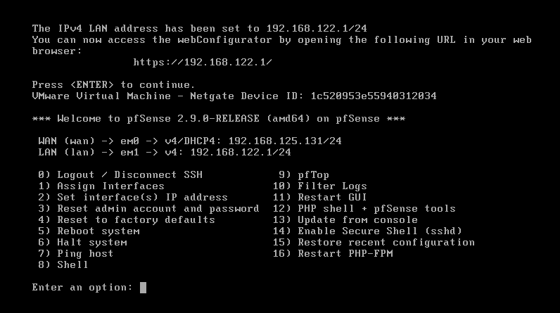
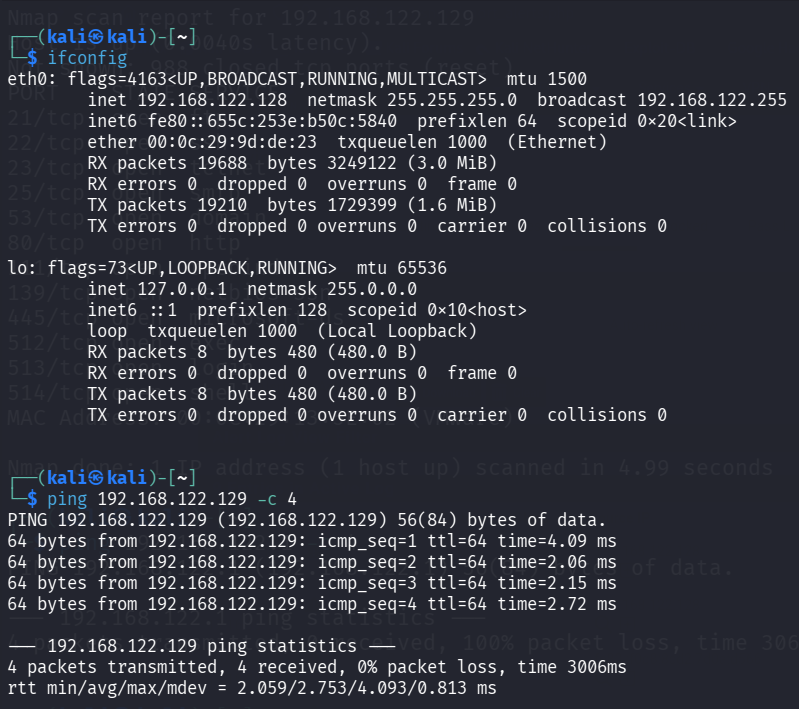
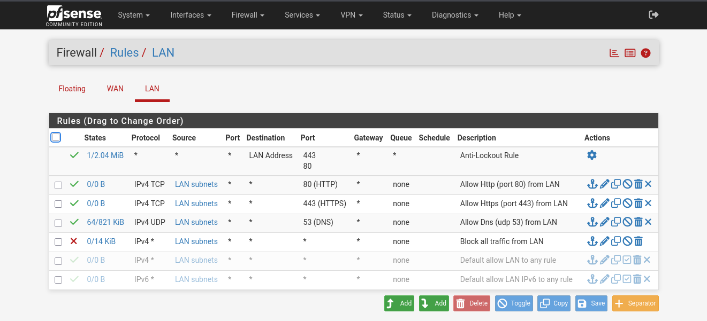
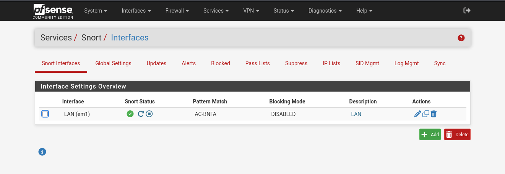
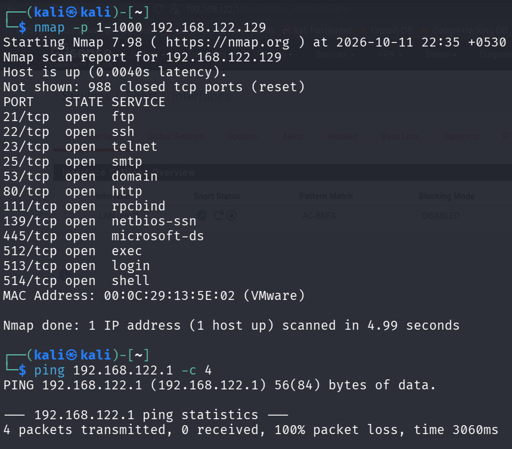
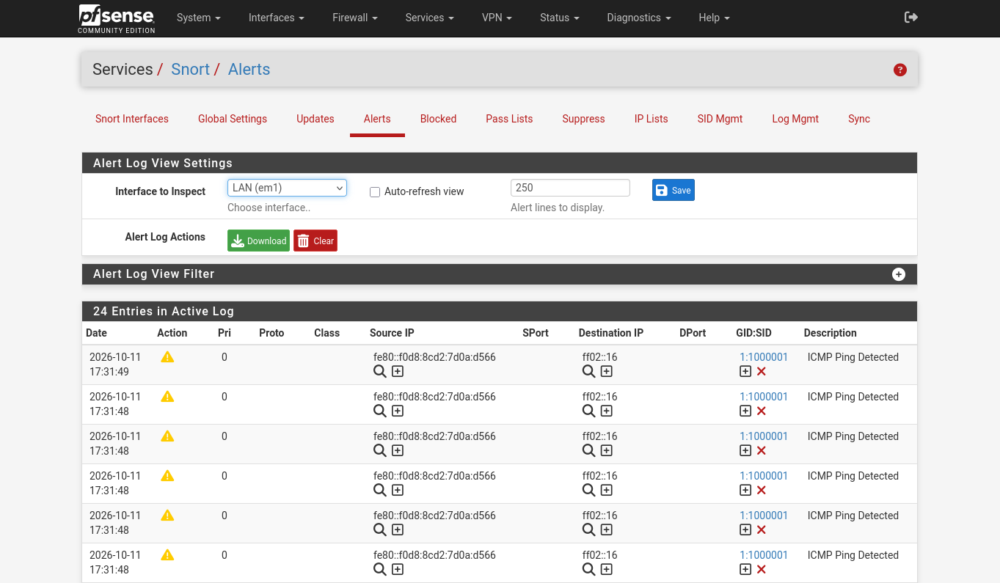

# Experiment 10: Setup and Test a Simple Intrusion Detection System (IDS) with Snort

## Aim

To install and configure Snort, simulate network attacks, and analyze suspicious traffic alerts.

---

## Objective

The objectives of this experiment are:

- To understand the working of an Intrusion Detection System (IDS).
- To install and configure Snort in the pfSense environment.
- To enable Snort monitoring on the LAN network interface.
- To configure Snort detection rules for identifying suspicious network activities.
- To generate network traffic using Kali Linux.
- To perform network scanning using Nmap.
- To examine Snort alerts and understand detected network activities.
- To create and test a custom Snort rule for detecting possible TCP SYN scan activity.

---

## Requirements

- pfSense firewall environment
- Kali Linux virtual machine
- Authorized lab target machine
- Snort package for pfSense
- Nmap network scanning tool
- Network connectivity between the lab systems
- GitHub
- Basic knowledge of network security and intrusion detection systems

---

## Theory

### IDS (Intrusion Detection System)

An Intrusion Detection System is a security system that monitors network traffic or system activities to identify suspicious behaviour and possible attacks. It generates alerts when potentially malicious activities are detected.

### Snort

Snort is an open-source network intrusion detection system used to monitor network traffic, detect suspicious activities, and generate security alerts. It analyzes packets using predefined and custom detection rules.

### Network Traffic Monitoring

Network traffic monitoring is the process of observing network packets to identify unusual communication patterns, unauthorized activities, and potential security threats.

### Snort Rules

Snort rules are predefined or custom instructions used to identify specific patterns in network traffic. When monitored traffic matches a rule, Snort can generate an alert to indicate suspicious activity.

### Nmap SYN Scan

An Nmap SYN scan is a network scanning technique that sends TCP SYN packets to identify open ports and discover running services on a target system. Repeated SYN requests can indicate possible network reconnaissance activity.

### Custom Detection Rule

A custom Snort rule is a user-defined rule created to detect a specific pattern of network traffic. It allows administrators to extend intrusion detection capabilities according to the security requirements of their network.

---

## Procedure

### Step 1: Verify pfSense Network Interfaces

The pfSense console was opened to examine the configured network interfaces.

The WAN and LAN interface IP addresses were identified and verified to understand the network configuration used during the experiment.

---

### Step 2: Verify Kali Linux Network Connectivity and Perform Nmap Scanning

The Kali Linux terminal was opened to examine the system's network configuration.

Network connectivity was tested using the ping command to verify communication with the lab network.

An Nmap scan was also performed against the authorized lab target to generate network traffic for intrusion detection testing.

---

### Step 3: Examine pfSense LAN Firewall Rules

The LAN firewall rules were opened in the pfSense web interface.

The configured rules were examined to understand how network traffic was allowed or blocked within the lab environment.

---

### Step 4: Enable Snort on the LAN Interface

The Snort configuration page was opened by navigating to Services → Snort → Interfaces.

Snort was enabled on the LAN interface so that it could monitor network traffic passing through the selected interface.

The interface configuration was examined to verify that Snort was enabled.

---

### Step 5: Generate Network Traffic Using Kali Linux

The Kali Linux terminal was used again to generate test network traffic.

Ping requests and an Nmap scan were performed against the authorized lab target to produce network activities for Snort monitoring.

These activities were used to examine how the intrusion detection system identifies and records network events.

---

### Step 6: Examine Snort Alerts

The Snort Alerts page was opened in the pfSense web interface.

The generated alerts were examined to identify detected network activities, including ICMP ping events.

The alert information demonstrated how Snort records monitored traffic events for security analysis.

---

## Improvement: Custom Snort Rule for TCP SYN Scan Detection

### Description

As an improvement to the basic experiment, a custom Snort detection rule was added to identify possible TCP SYN scan activity.

An Nmap SYN scan was performed from Kali Linux against the authorized lab target to generate the corresponding scanning traffic.

The Snort alert log was then examined to verify whether the custom detection rule identified the scanning activity.

This improvement demonstrated how custom Snort rules can extend the detection capabilities of an IDS and help identify specific suspicious network activities.

---

## Files Included

### Output Files

The `Outputs` folder contains the following screenshots:

- `ss1.png` — pfSense console showing WAN and LAN interface IP addresses.
- `ss2.png` — Kali Linux terminal showing network configuration, ping results, and Nmap scan output.
- `ss3.png` — pfSense LAN firewall rules showing allowed and blocked traffic.
- `ss4.png` — Snort Interfaces page showing Snort enabled on the LAN interface.
- `ss5.png` — Kali Linux terminal showing Nmap scan and ping results.
- `ss6.png` — Snort Alerts page displaying detected ICMP ping events.

---

## Result

Snort was configured to monitor network traffic on the LAN interface of pfSense. Network activities were generated using Kali Linux through ping requests and Nmap scanning.

Snort recorded detected network events in its alert log, including ICMP ping activity.

As an improvement, a custom Snort rule was added to identify possible TCP SYN scan activity. The Nmap SYN scan was performed against the authorized lab target, and the resulting alert log was examined to verify the custom detection.

Detailed outputs and screenshots can be viewed by scanning the QR code provided in the lab manual.

---

## Conclusion

The experiment demonstrated the setup and operation of Snort as a network intrusion detection system. Snort monitored LAN traffic, identified network activities, and generated alerts for security analysis.

The additional custom-rule activity demonstrated how user-defined detection rules can extend Snort's capabilities to identify specific suspicious network behaviours, such as possible TCP SYN scanning.
