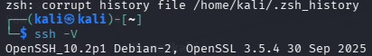
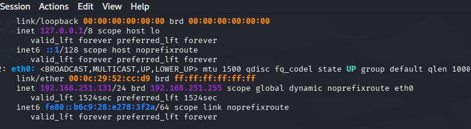
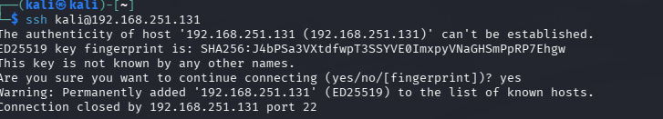
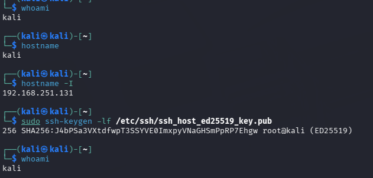
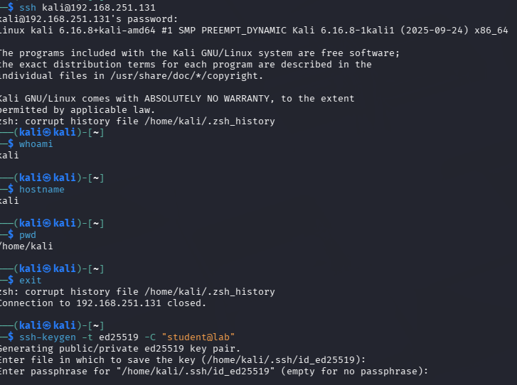
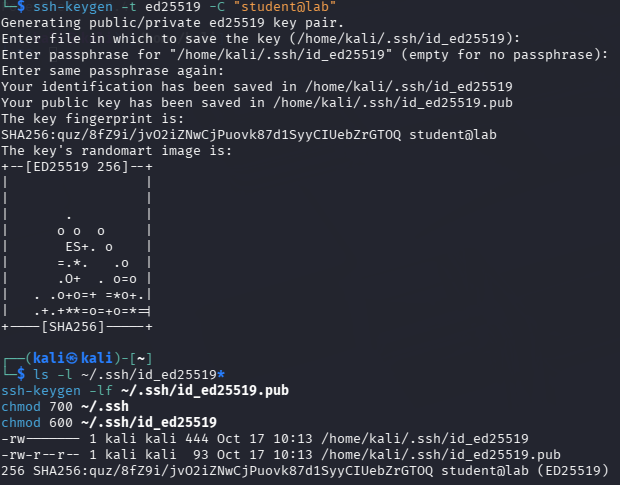
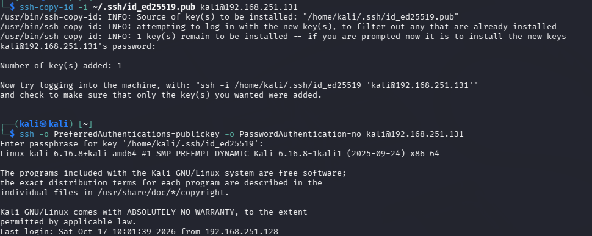
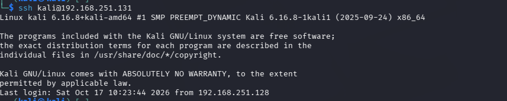

# Experiment 6: Establish Secure Remote Login Using SSH

## Aim

To demonstrate secure remote server access using SSH with password-based and public-key authentication, and to examine SSH host-key verification.

---

## Objective

The objectives of this experiment are:

- To check the installed OpenSSH client on Kali Linux.
- To install and configure the OpenSSH server on Ubuntu.
- To establish a password-based SSH connection between Kali Linux and Ubuntu.
- To verify the remote username, hostname, and working directory.
- To generate an Ed25519 SSH key pair on the client.
- To inspect the generated key files and public-key fingerprint.
- To configure appropriate permissions for the SSH directory and private key.
- To transfer the public key to the Ubuntu server.
- To test public-key authentication without password fallback.
- To examine SSH host-key verification and changed host-key warnings.
- To use the SSH agent to manage the client private key.

---

## Requirements

- Kali Linux
- Ubuntu Linux
- OpenSSH client
- OpenSSH server
- Linux Terminal
- GitHub
- Basic knowledge of Linux commands and SSH

---

## Theory

### Secure Shell (SSH)

SSH is a network protocol used to establish secure remote connections between computers over an unsecured network. It encrypts communication between the client and server, helping protect transmitted data and authentication information.

### OpenSSH Client and Server

OpenSSH is an open-source implementation of the SSH protocol. The SSH client initiates a connection to a remote system, while the SSH server accepts connections and authenticates users. SSH commonly uses TCP port 22.

### Password-Based Authentication

Password-based authentication verifies a user's identity by requiring the account password. In this experiment, the Kali Linux client was used to access the Ubuntu server through an SSH connection.

### Public-Key Authentication

Public-key authentication uses a cryptographic key pair consisting of a private key and a public key. The private key remains on the client, while the corresponding public key is placed in the server account's `authorized_keys` file. The client can then authenticate using the private key instead of relying on password authentication.

### SSH Host-Key Verification

An SSH host key helps the client verify the identity of the remote server. The client's `known_hosts` file stores previously accepted server host keys. If the server presents a different key, SSH may display a changed-host-identification warning. The change must be verified before reconnecting because it could indicate a legitimate server change or a possible man-in-the-middle attack.

### SSH Agent

The SSH agent is a background process that can hold private keys for authentication, allowing the client to use an added key without repeatedly loading it manually.

---

## Procedure

### Step 1: Check the SSH Client

The installed OpenSSH client on Kali Linux was checked using the following command:

`ssh -V`

The command displayed the installed SSH client version and confirmed that the client utility was available.

---

### Step 2: Establish a Password-Based SSH Connection

The Kali Linux client was used to connect to the Ubuntu server using the account username and server IP address.

`ssh tanish-sharma@192.168.125.129`

After checking the server's host-key information, the account password was entered to establish the remote shell.

Inside the remote Ubuntu shell, the following commands were executed:

- `whoami` — displayed the remote username.
- `hostname` — displayed the server hostname.
- `pwd` — displayed the current working directory.

The `exit` command was then used to return to the Kali Linux terminal.

---

### Step 3: Generate an Ed25519 SSH Key Pair

An Ed25519 SSH key pair was generated on Kali Linux using:

`ssh-keygen -t ed25519 -C "student@lab"`

The key-generation process created a private key and a corresponding public key in the client's `.ssh` directory. The private key was retained on Kali Linux, while the public key was used for server-side authorization.

The generated key files were then examined using:

`ls -l ~/.ssh/id_ed25519*`

The public-key fingerprint was displayed using:

`ssh-keygen -lf ~/.ssh/id_ed25519.pub`

This provided a way to inspect the generated key files and identify the client's public key by its fingerprint.

---

### Step 4: Configure SSH Key Permissions

Appropriate permissions were applied to the SSH directory using:

`chmod 700 ~/.ssh`

The private key's permissions were restricted using:

`chmod 600 ~/.ssh/id_ed25519`

These settings restrict access to the SSH directory and private key, helping protect the client's authentication credentials.

---

### Step 5: Copy the Public Key to the Ubuntu Server

The client's public key was transferred to the Ubuntu account using:

`ssh-copy-id -i ~/.ssh/id_ed25519.pub tanish-sharma@192.168.125.129`

This command installed the public key in the remote account's `authorized_keys` file, enabling the server to authorize authentication using the corresponding private key.

The public-key authentication process was then tested with password authentication disabled:

`ssh -o PreferredAuthentications=publickey -o PasswordAuthentication=no tanish-sharma@192.168.125.129`

After connecting, the `whoami` and `hostname` commands were executed inside the Ubuntu shell to verify the remote account and server. The `exit` command was used to return to Kali Linux.

---

### Step 6: Start the SSH Agent and Add the Private Key

The SSH agent was started on Kali Linux using:

`eval "$(ssh-agent -s)"`

The generated private key was added to the agent using:

`ssh-add ~/.ssh/id_ed25519`

The agent can hold the key for use during subsequent SSH authentication attempts.

---

### Step 7: Reconnect to the Ubuntu Server

The Kali Linux client was used to establish another SSH connection to the Ubuntu server:

`ssh tanish-sharma@192.168.125.129`

The connection was used to examine remote access after the SSH key had been added to the agent. The `exit` command was used to terminate the remote session and return to Kali Linux.

---

## Improvement: SSH Host-Key Change Detection

### Description

The experiment was extended to examine SSH host-key verification when the server presented a host key different from the one previously stored in the client's `known_hosts` file.

SSH displayed a warning about the changed host identification. This warning indicates that the server's identity must be verified independently before reconnecting.

A changed host key may result from a legitimate server rebuild or host-key replacement, but it may also indicate a possible man-in-the-middle attack. Therefore, the new fingerprint should be verified through a trusted method before the changed key is accepted.

This improvement demonstrated the importance of SSH host-key verification in detecting unexpected changes in server identity.

---

## Files Included

### Code Files

#### [`server_commands.sh`](Codes/server_commands.sh)

Contains the Ubuntu-side commands used to install and start the OpenSSH server, check the service status, verify that SSH is listening on port 22, inspect server information, and display the server's SSH host-key fingerprint.

#### [`client_commands.sh`](Codes/client_commands.sh)

Contains the Kali Linux commands used to check the SSH client, establish remote connections, generate and inspect the Ed25519 key pair, configure permissions, copy the public key, test public-key authentication, and use the SSH agent.

---

### Output Files

The `Outputs` folder contains the screenshots documenting the experiment:

- `ss1.png` — SSH client version check
- `ss2.png` — Password-based SSH connection
- `ss3.1.png` — SSH key pair generation
- `ss3.2.png` — Key files and public-key fingerprint
- `ss4.png` — SSH key permission configuration
- `ss5.1.png` — Public-key transfer to Ubuntu
- `ss5.2.png` — Public-key authentication test
- `ss6.png` — SSH agent and private-key addition
- `ss7.png` — SSH reconnection

---

## Result

The OpenSSH client and server were examined, and a password-based SSH connection was established between Kali Linux and Ubuntu. An Ed25519 key pair was generated, the public key was transferred to the server, and public-key authentication was tested with password authentication disabled. The SSH agent was also used to manage the private key. The experiment further examined the significance of changed host-key warnings when verifying server identity.

---

## Conclusion

