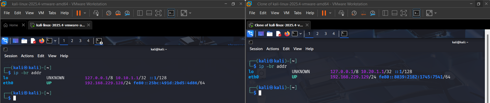
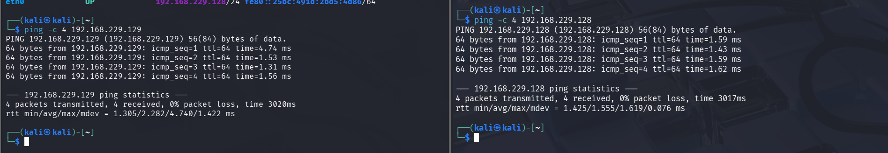
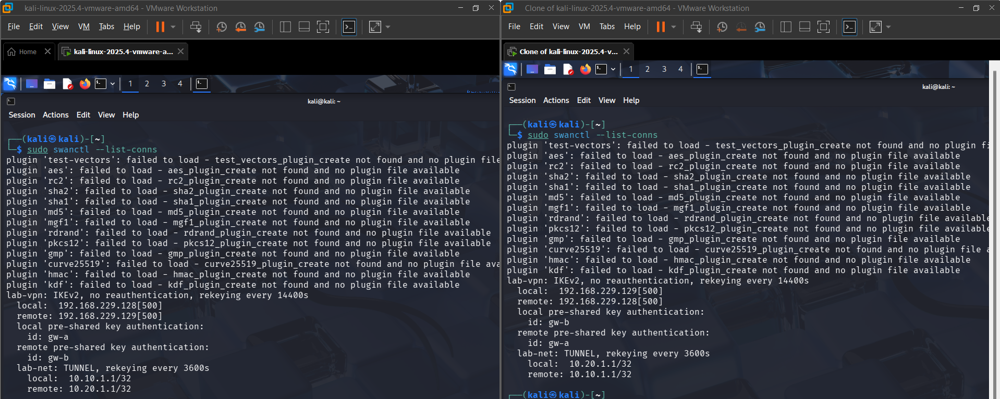
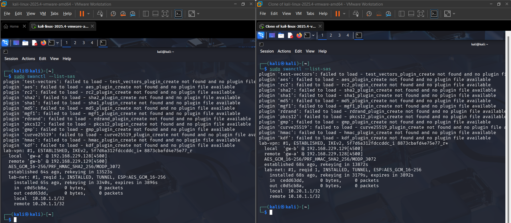
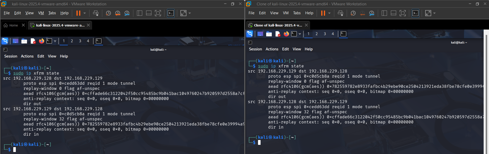
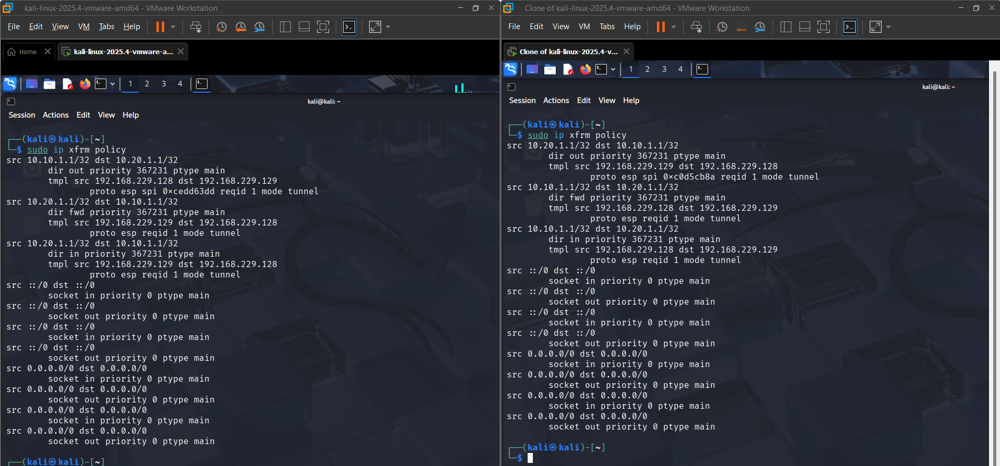
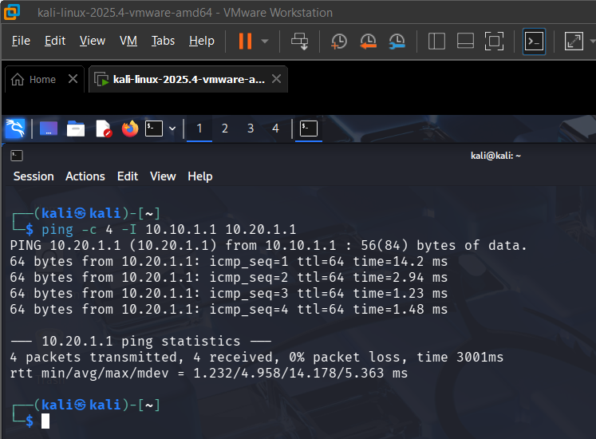
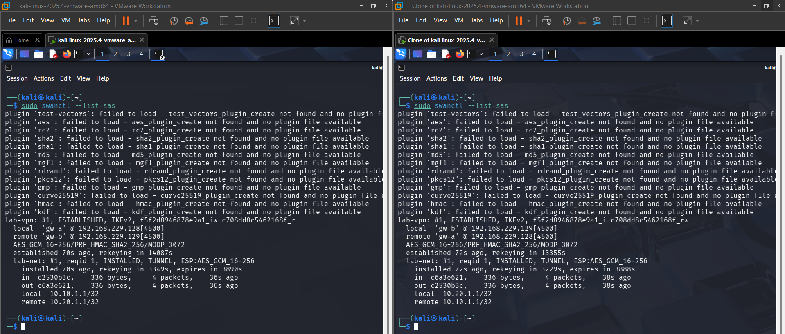

# Experiment 9: Configure and Analyze IPsec VPN in Tunnel Mode

## 1. Aim / Objective

To configure a two-host IKEv2 tunnel, test protected traffic, and analyze the outer packets.

## 2. Requirements

- Two Kali Linux virtual machines (Gateway A and Gateway B)
- strongSwan IPsec implementation
- Terminal access with administrative privileges
- Network connectivity between both gateways
- Wireshark or packet inspection utilities

## 3. Theory

**IPsec (Internet Protocol Security):** A suite of protocols that provides encryption, authentication, and integrity protection for IP communication.

**Tunnel Mode:** An IPsec mode in which the complete original IP packet is protected and encapsulated inside a new outer IP packet.

**IKEv2 (Internet Key Exchange Version 2):** A protocol used to authenticate VPN peers, negotiate security parameters, and establish encryption keys.

**ESP (Encapsulating Security Payload):** An IPsec protocol that provides encryption, integrity, and anti-replay protection.

**Pre-Shared Key (PSK):** A common secret used by both VPN gateways for peer authentication.

**strongSwan:** An open-source implementation of IPsec used to configure and manage secure VPN connections.

## 4. Procedure

### Step 1: Configure IP Addresses of Both Gateways

Two Kali Linux virtual machines are configured as Gateway A and Gateway B. Their outer IP addresses are assigned as `192.168.229.128` and `192.168.229.129`, respectively. The inner tunnel addresses `10.10.1.1/32` and `10.20.1.1/32` are assigned to the respective gateways using the loopback interface.

### Step 2: Verify Outer Network Connectivity

The outer network connectivity between both gateways is verified using ping requests. This ensures that the gateways can communicate before establishing the IPsec tunnel.

### Step 3: Verify Loaded strongSwan Configuration

The strongSwan configuration is loaded and checked using the `swanctl` utility. The configured IKEv2 connection, peer identities, tunnel selectors, and authentication settings are verified on both gateways.

### Step 4: Verify Established IKE SA and CHILD SA

The IPsec connection is initiated from Gateway A. The IKE Security Association (IKE SA) and CHILD Security Association (CHILD SA) are checked using:

`sudo swanctl --list-sas`

The output confirms the established VPN connection and negotiated security parameters.

### Step 5: Verify IPsec XFRM States

The installed IPsec security states are inspected using:

`sudo ip xfrm state`

The output displays the Security Parameter Index (SPI), encryption algorithm, and other parameters associated with the IPsec tunnel.

### Step 6: Verify IPsec XFRM Policies

The installed IPsec policies are inspected using:

`sudo ip xfrm policy`

These policies specify which traffic is protected by the IPsec tunnel and the security processing applied to matching packets.

### Step 7: Verify Protected Traffic Through the IPsec Tunnel

Protected communication is tested by sending inner-network ping requests using:

`ping -I 10.10.1.1 10.20.1.1`

The successful replies demonstrate communication between the inner tunnel addresses through the IPsec VPN.

### Step 8: Verify IPsec Traffic Counters

The IPsec Security Association traffic counters are inspected to verify the number of packets and bytes transferred through the tunnel in both directions. Increasing counters confirm that traffic is being processed by IPsec.

## 5. Improvement

A pre-shared key authentication test was performed by temporarily configuring an incorrect key on one gateway. The authentication attempt failed, and the tunnel was not established. After restoring the correct shared key, the IPsec tunnel was successfully re-established, demonstrating the role of PSK-based peer authentication.

## 6. Files Included

- [Commands.sh](Codes/Commands.sh): Contains the commands used during the experiment along with their descriptions.
- **Outputs/ss1.png – ss8.png:** Screenshots documenting IP addressing, connectivity, configuration verification, tunnel establishment, IPsec states and policies, protected traffic, and traffic counters.

## 7. Result

- The IKEv2 Security Association and IPsec CHILD Security Association were established between both gateways.
- The negotiated ESP encryption algorithm was **AES-GCM-16-256**.
- The inner-network ping returned **4 out of 4 replies with 0% packet loss**.
- IPsec traffic counters recorded **4 packets and 336 bytes transferred in each direction**.
- An incorrect pre-shared key was rejected during authentication, while restoring the correct key allowed the tunnel to establish again.

Detailed outputs and screenshots can be viewed by scanning the QR code provided in the lab manual.

## 8. Conclusion

The site-to-site IPsec VPN demonstrated secure communication between two gateways using IKEv2, ESP encryption, tunnel mode, and pre-shared key authentication.

